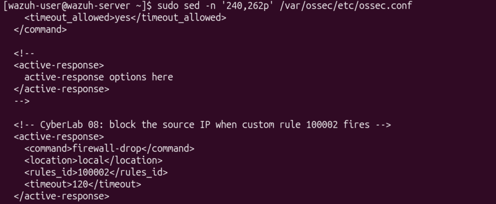
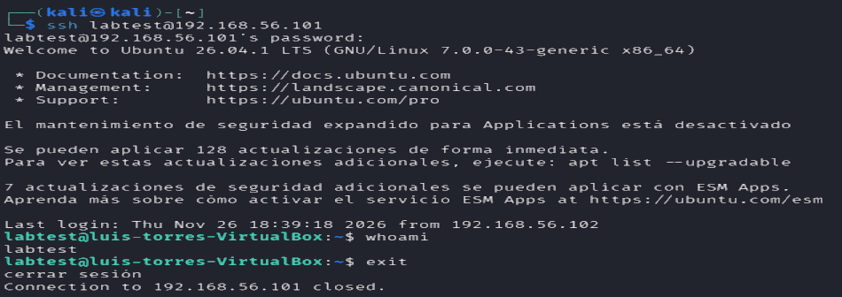
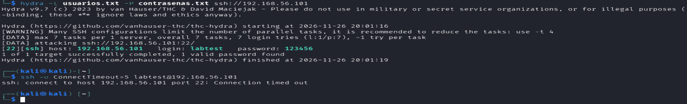
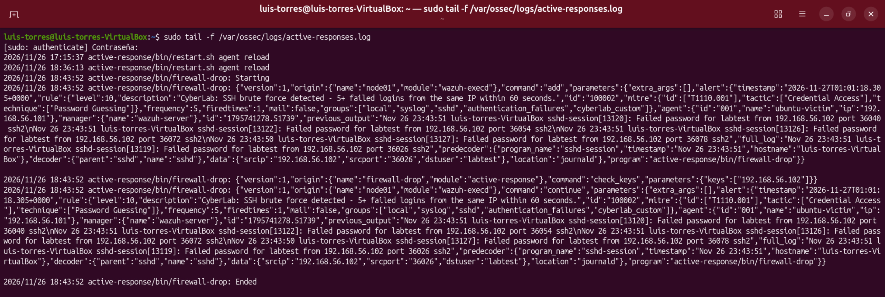
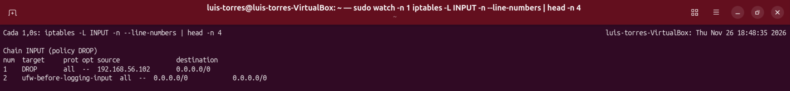
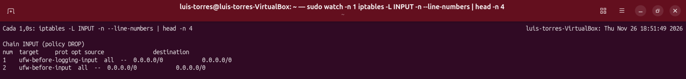

# CyberLab 08 — Wazuh Active Response: Automated SSH Brute-Force Containment

## Objective
Close the loop opened in CyberLab 06 (manual detection script) and CyberLab 07 (SIEM detection with a custom rule): configure Wazuh so that when the custom brute-force rule `100002` fires, the monitored host **automatically blocks the attacking IP**, and verify the whole sequence (detection, order, block, automatic unblock) with a real Hydra attack.

**MITRE ATT&CK:** T1110 (Brute Force) / T1110.001 (Password Guessing)

**Lab date:** November 26, 2026
**Manager local time:** America/New_York (EST, UTC−05:00)

## Environment

| Role | VM | OS | IP (host-only) |
|---|---|---|---|
| Victim / agent | CyberLab-Ubuntu | Ubuntu 26.04.1 LTS | 192.168.56.101 |
| Attacker | Kali | Kali Linux 2026.3 | 192.168.56.102 |
| SIEM / manager | Wazuh v4.14.11 OVA | Wazuh all-in-one appliance | 192.168.56.103 |

The rest of the setup (host-only network, UFW rule for SSH, `labtest` account, Wazuh agent `ubuntu-victim`, custom rule `100002`) comes from CyberLab 06 and 07.

## Part 1 — Prerequisites

Active response runs on the monitored host, so before configuring anything the victim was checked for what the response needs.

On the victim:
cat > README.md << 'READMEEOF'
# CyberLab 08 — Wazuh Active Response: Automated SSH Brute-Force Containment

## Objective
Close the loop opened in CyberLab 06 (manual detection script) and CyberLab 07 (SIEM detection with a custom rule): configure Wazuh so that when the custom brute-force rule `100002` fires, the monitored host **automatically blocks the attacking IP**, and verify the whole sequence (detection, order, block, automatic unblock) with a real Hydra attack.

**MITRE ATT&CK:** T1110 (Brute Force) / T1110.001 (Password Guessing)

**Lab date:** November 26, 2026
**Manager local time:** America/New_York (EST, UTC−05:00)

## Environment

| Role | VM | OS | IP (host-only) |
|---|---|---|---|
| Victim / agent | CyberLab-Ubuntu | Ubuntu 26.04.1 LTS | 192.168.56.101 |
| Attacker | Kali | Kali Linux 2026.3 | 192.168.56.102 |
| SIEM / manager | Wazuh v4.14.11 OVA | Wazuh all-in-one appliance | 192.168.56.103 |

The rest of the setup (host-only network, UFW rule for SSH, `labtest` account, Wazuh agent `ubuntu-victim`, custom rule `100002`) comes from CyberLab 06 and 07.

## Part 1 — Prerequisites

Active response runs on the monitored host, so before configuring anything the victim was checked for what the response needs.

On the victim:

which iptables
sudo iptables -L INPUT -n --line-numbers | head -n 15
sudo ls /var/ossec/active-response/bin/

- `iptables` is available (`/usr/sbin/iptables`).
- The `INPUT` chain contained only UFW's chains, with no manual rules. This is the "before" state used for comparison later.
- The agent ships the `firewall-drop` script (plus `firewalld-drop`, `host-deny`, `disable-account` and others).

On the manager, `ossec.conf` already defined the `firewall-drop` command (with `timeout_allowed` set to `yes`, which lets a block expire on its own), but the `<active-response>` block was only a commented example. No response was active.

## Part 2 — Configuring the response

The `<active-response>` block lives on the **manager**: the command defines *what* can run, and this block defines *when* and *where*. A backup of `ossec.conf` was made first, and the block was inserted after the commented example:

```xml
<!-- CyberLab 08: block the source IP when custom rule 100002 fires -->
<active-response>
  <command>firewall-drop</command>
  <location>local</location>
  <rules_id>100002</rules_id>
  <timeout>120</timeout>
</active-response>
```

- `command`: the existing `firewall-drop` command.
- `location local`: runs on the agent that generated the alert, which is the host that has to block.
- `rules_id 100002`: only the custom brute-force rule triggers it.
- `timeout 120`: the block is lifted automatically after 120 seconds.



The change was applied safely: validated first, restarted only if valid, then the agent connection was checked.

sudo cp /var/ossec/etc/ossec.conf /var/ossec/etc/ossec.conf.bak
sudo /var/ossec/bin/wazuh-analysisd -t && echo "CONFIG OK" && sudo systemctl restart wazuh-manager
sudo /var/ossec/bin/agent_control -l


The configuration test passed, the manager came back as `active (running)`, and `ubuntu-victim` was listed as `Active`.

## Part 3 — Baseline: normal access works

Before attacking, Kali logged in over SSH with valid credentials, to document that the host was reachable:



## Part 4 — Attack, detection and block

A live view of the agent's active-response log was left running on the victim, then the same Hydra attack from the previous labs was launched from Kali, followed immediately by an SSH connection attempt:

sudo tail -f /var/ossec/logs/active-responses.log
hydra -L usuarios.txt -P contrasenas.txt ssh://192.168.56.101
ssh -o ConnectTimeout=5 labtest@192.168.56.101


The SSH attempt that worked in Part 3 now failed:



On the victim, the agent's log recorded the whole sequence:



It shows `firewall-drop` starting, a command `add` carrying rule `100002` (level 10, MITRE T1110.001) with `srcip` `192.168.56.102`, the failed-password lines that triggered it, and the script ending. The alert was created at 01:01:18.305 UTC (20:01:18 local) and the script ran in the same second, so **detection-to-block took under one second**.

## Part 5 — The block and its automatic expiry

With `watch` refreshing the firewall chain every second, the block was observed in place:

sudo watch -n 1 "iptables -L INPUT -n --line-numbers | head -n 4"




The rule sits at position 1, ahead of all of UFW's chains, so it takes priority over them. About three minutes later, with no action from anyone, it was gone:



This matches the 120-second `timeout` and returns the firewall to the exact state recorded in Part 1.

## Findings

**1. Reactive containment does not undo a fast compromise.** Hydra still reported the valid password (`123456`), finishing at 20:01:19, one second after the alert. The correct guess was already in flight when the block landed. The response stopped further access (the SSH attempt timed out), but it cannot recall a credential that was already guessed. Automated response limits how far an attacker gets; it does not replace preventing the compromise.

**2. Clock drift between VMs.** The victim's own log stamped the event at 18:43:52, while the manager stamped the alert at 20:01:18, the real time. The victim's clock was about 78 minutes behind, most likely after the VM was paused between sessions. The response worked because the manager correlates using its own receipt time, but in a real environment unsynchronized clocks would break the correlation of logs from different hosts. Time must be synchronized (NTP) on every monitored system.

## Conclusion
Wazuh's active response turned the detection built in CyberLab 07 into automated containment. The full loop was verified end to end: failed logins on the agent, correlation on the manager (rule `100002`), an order sent back to the agent, an `iptables` block within a second, and an automatic unblock after the timeout. Together, CyberLab 06, 07 and 08 cover the incident-response cycle for this attack: detect, alert, contain.

## Mitigation and risks
- **Preventive controls still come first:** key-only SSH (`PasswordAuthentication no`), strong passwords, account lockout and MFA. Finding 1 shows why a reactive block is not enough.
- **Self-inflicted outages:** blocking by source IP can lock out legitimate users, or be abused by spoofing a trusted address. Critical IPs (administrators, monitoring) should be allow-listed, and the `timeout` kept short.
- **Repeat offenders:** Wazuh supports increasing the block time for sources that return after being unblocked, which a fixed 120 seconds does not do.
- **Synchronize clocks (NTP)** on all agents and the manager.

## Limitations / next steps
- Tested with a single attacker and a single agent; a distributed attack from many IPs would not be stopped by blocking one address.
- The block is at the host firewall only; a network-level control would stop the traffic earlier.
- Follow-up done in [Lab 09](https://github.com/ltorres-security/CyberLab-Wazuh-Clock-Sync-Repeat-Offenders-09): the clock drift was fixed with chrony and repeat-offender escalation was tested (120 s, then 181 s).
